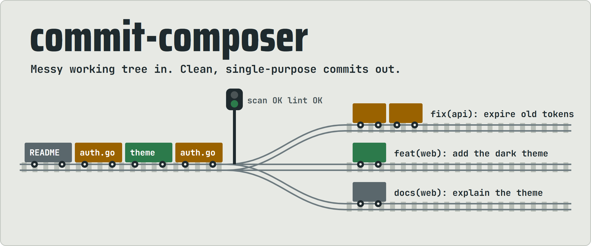
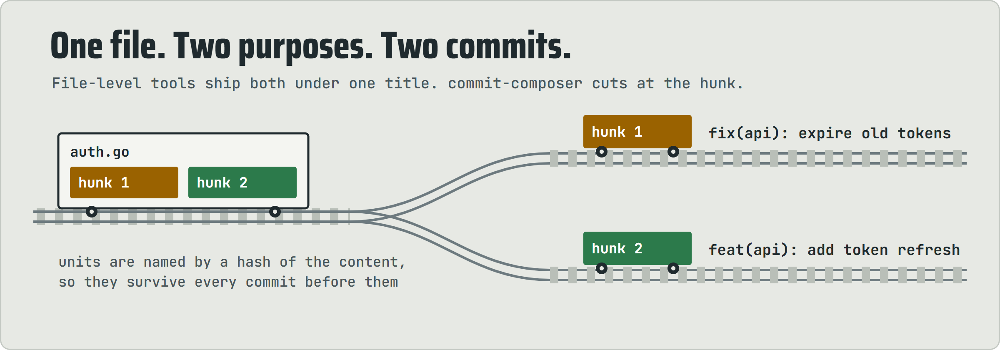
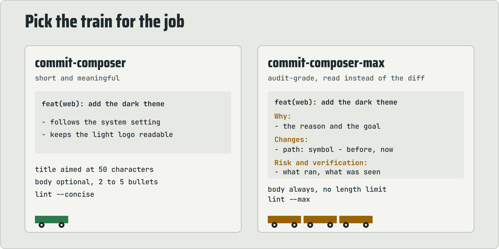
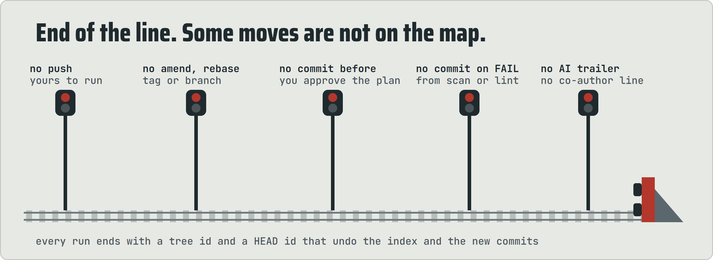

<h1 align="center"><picture><source media="(prefers-color-scheme: dark)" srcset="assets/hero-dark.webp"></picture></h1>

**Stop shipping "misc fixes". Point an agent at a messy working tree and get back a clean series of commits, each with one purpose and a title that says it.**

## Install

```bash
npx skills add the-khiem7/commit-composer
npx skills add the-khiem7/commit-composer --skill commit-composer
```

The first line installs both skills, the second only one. Both are explicit entrypoints: call them by name, they never fire on their own.

<p align="center">
<a href="#how-it-works"><picture><source media="(prefers-color-scheme: dark)" srcset="assets/nav-how-dark.webp"></picture></a>
<a href="#two-skills"><picture><source media="(prefers-color-scheme: dark)" srcset="assets/nav-skills-dark.webp"></picture></a>
<a href="#what-it-will-never-do"><picture><source media="(prefers-color-scheme: dark)" srcset="assets/nav-never-dark.webp"></picture></a>
<a href="#technical"><picture><source media="(prefers-color-scheme: dark)" srcset="assets/nav-tech-dark.webp"></picture></a>
</p>

## Cut at the hunk, not the file

<picture><source media="(prefers-color-scheme: dark)" srcset="assets/scene-hunks-dark.webp"></picture>

Real work is tangled: one file holds a bug fix and half a feature. commit-composer splits the working tree into hunks, groups them by project, action, and target, and gives every group its own Conventional Commits message. No `git add -p` sessions, no file-sized compromises.

## How it works

Every run follows the same line, and it always stops at the plan. Nothing is staged or committed until you approve the grouping, and you can regroup, rename, or drop any group first.

<picture><source media="(prefers-color-scheme: dark)" srcset="assets/flow-dark.webp"></picture>

Before every commit, two checks run on what is about to land:

| Gate | What it does |
|---|---|
| `commitkit.sh scan` | reads the staged diff for keys and credentials; it names the file and the rule, never the value |
| `commitkit.sh lint` | checks the message against the format; `--concise` or `--max` per skill |

Either one prints FAIL, and that commit does not happen. Both print an `OK` line on a pass.

## Two skills

<picture><source media="(prefers-color-scheme: dark)" srcset="assets/skills-dark.webp"></picture>

| You want | Use | You get |
|---|---|---|
| commits with short, meaningful messages | `commit-composer` | a title aimed at 50 characters and an optional body of 2 to 5 one-line bullets |
| a log another agent can audit without reading the code | `commit-composer-max` | `Why:`, `Changes:`, and `Risk and verification:` blocks naming every changed file and symbol, the risks, and what was checked |

The title is always `type(project): subject`. The project is the name of the baseline pack that claims the changed path, else the folder of the nearest manifest. A message never carries a pack identifier, phase number, or pack filename.

## What it will never do

<picture><source media="(prefers-color-scheme: dark)" srcset="assets/never-dark.webp"></picture>

Every run ends with the starting tree id and HEAD id: `git read-tree <tree id>` restores the index, and `git reset -q <head id>` removes the new commits while keeping every change in the working tree.

## Technical

Both skills ship the same `scripts/commitkit.sh`. It is POSIX sh and POSIX awk only, runs git only to read, and never writes a file, the index, or the network. Every git command that writes is the agent's, so the tool is safe to run inside anyone's repository.

<picture><source media="(prefers-color-scheme: dark)" srcset="assets/tech-units-dark.webp"></picture>

| Command | What it computes |
|---|---|
| `hunks` | one line per unit: id, file, kind, old range, new range, `+added -deleted`, first changed line. Stops when the merge is unresolved |
| `patch <id> ...` | a patch holding only the named units, for `git apply --cached --unidiff-zero`. Exits 1 on an unknown id |
| `scan` | FAIL findings in the staged diff by rule and `file:line`, never the value |
| `lint [--concise\|--max] <msgfile>` | FAIL and WARN findings in a commit message |

Exit status is 0 clean, 1 FAIL present, 2 usage. `scan` and `lint` print an `OK` line on a pass, so a pass never looks like a run that did not happen.

### Ids that survive every commit

A unit id is a hash of its file and content, not its position. Line numbers move after every commit; the content does not, so `hunks` is recomputed before each group and the same ids still name the same changes. `hunks` and `patch` run one shared awk program, so both compute the same id for the same unit.

### Offsets that stay on the right line

<picture><source media="(prefers-color-scheme: dark)" srcset="assets/tech-offset-dark.webp"></picture>

### What the gates look for

| Gate | Rules |
|---|---|
| `scan`, file names | private key files (`.pem`, `.key`, `.p12`, `.pfx`, `.jks`, `.ppk`, `id_rsa` and kin), Terraform state, `.env` files other than examples and templates, an AWS credentials file |
| `scan`, added lines | a private key block, an AWS access key id, an AWS secret access key, a quoted password, secret, token, or API key assignment that is not a placeholder |
| `lint`, title | `type(project): subject` with one of eleven types, at most 72 characters; WARN over 50 in `--concise` and on a final period |
| `lint`, body | a blank second line, every line a bullet or a label ending in a colon; `--concise` allows no labels and at most 5 bullets, `--max` needs at least one bullet |
| `lint`, anywhere | no en or em dash, no pack identifier, phase number, pack path, or pack filename, no AI or co-author trailer; WARN on a reference to another commit by position and on vague words in `--max` |

Both gates read patterns. They are a floor, not a verdict: a secret without a rule, or a bullet with an invented reason, passes them.

### Portability

The script sets `LC_ALL=C` and avoids gawk extensions and regex intervals, so one file runs under dash and mawk, macOS sh and BWK awk, and Git for Windows sh and gawk. It passes `BINMODE=3` to awk because gawk on Windows otherwise strips the carriage return from a CRLF file's diff lines, and that patch then fails to apply.
